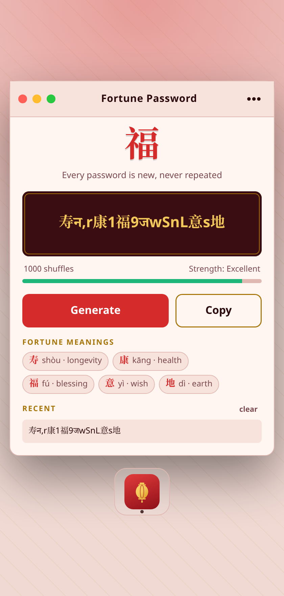
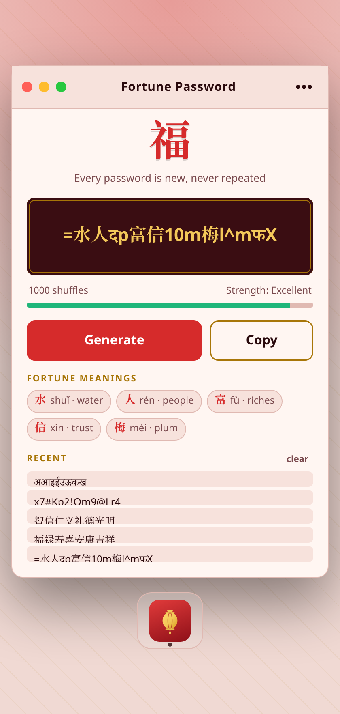

<div align="center">

<a href="https://github.com/technicalnihilist-lgtm/Chinese-Password-Generator/stargazers"></a>&nbsp;<a href="https://github.com/technicalnihilist-lgtm/Chinese-Password-Generator/network/members"></a>

<h3>福运密码 · Fortune Password — an offline password generator for Android and the web with Chinese 福…</h3>

   

<a href="https://github.com/technicalnihilist-lgtm/Chinese-Password-Generator/releases/latest"></a>

<b>Support the work</b>

  

<sub>Donations aren't live yet — Paytm, UPI, PayPal and Buy&nbsp;Me&nbsp;a&nbsp;Coffee all show <b>coming soon</b>. Until then, a ⭐ star is the best support.</sub>

<a href="https://github.com/technicalnihilist-lgtm/Chinese-Password-Generator/releases/latest"></a>  <a href="https://github.com/technicalnihilist-lgtm/Chinese-Password-Generator/releases"></a>

<h4>Get it from</h4>

<a href="https://github.com/technicalnihilist-lgtm/Chinese-Password-Generator/releases"></a> <a href="https://github.com/technicalnihilist-lgtm/Chinese-Password-Generator/archive/refs/heads/main.zip"></a>

</div>

---

---

## Screenshots

| Main screen | Features / settings | Animation settings |
|---|---|---|
|  |  |  |

| Language — हिन्दी | Language — 中文 | Dark mode |
|---|---|---|
|  |  |  |

| Fortune meanings | Recent passwords |
|---|---|
|  |  |

---

## What it does

A macOS-style window floats over a Chinese New Year paper backdrop. Press **Generate** and a password is built from the character sets you choose, shuffled 1 000 times by default with a live animation, then measured for strength.

**Character sets (mix any of them)**

| Set | Contents |
|---|---|
| `A-Z` | 26 uppercase Latin letters |
| `a-z` | 26 lowercase Latin letters |
| `0-9` | 10 digits |
| Symbols | `!@#$%^&*()-_=+[]{};:,.?~` |
| 福 | 56 Chinese characters — 福禄寿喜龙凤春夏秋冬山水火木金土天地人心云月星梅兰竹菊鹤松安康吉祥如意财富平和德仁义礼智信勇光明华夏 |
| अ | 44 Devanagari letters |

**Fortune meanings** — every 汉字 in a generated password is shown underneath with its pinyin and meaning (福 fú · blessing, 智 zhì · wisdom, 竹 zhú · bamboo …). A password you can actually remember.

**Everything else**

- True CSPRNG (`crypto.getRandomValues`) with rejection sampling — no `Math.random`, no modulo bias
- Length 4–128 characters, at least one character from every enabled set, guaranteed
- No-repeat guarantee: a password is never handed out twice, and the last six stay in a Recent list
- Entropy read-out (bits) and a four-level strength meter
- Avoid look-alikes option removes `O 0 I l 1 |`
- Shuffle count (1–1000) and shuffle duration (0.3–4 s) are adjustable
- Three languages — English, हिन्दी, 中文 — switchable live, including the UI, labels and the page title
- Light / auto / dark theme, four accent colours, open-close, bounce and shuffle animations each toggleable
- Everything persists in `localStorage`; Reset all clears it
- Keyboard: `Enter` / `Space` generates, `Ctrl+C` copies
- Installable as a PWA, and works from `file://` with no server

---

## Install the Android app

1. Download **`fortune-password-1.0.0.apk`** from [Releases](../../releases/latest) (or from [`apk/`](apk/)).
2. Open it on the phone and allow install from unknown sources when prompted.
3. It asks for no permissions — there is no `INTERNET` permission in the manifest.

| | |
|---|---|
| Package | `com.fuyun.password` |
| Version | 1.0.0 (versionCode 1) |
| Size | 166 KB |
| Min / target SDK | 23 (Android 6.0) / 34 (Android 14) |
| Signature | APK Signature Scheme v1 + v2 + v3, RSA 2048 |
| Permissions | none |

The APK is a thin native shell: a `WebView` that loads `file:///android_asset/index.html` with DOM storage and JavaScript enabled, plus a `JavascriptInterface` clipboard fallback so **Copy** works even where the async Clipboard API is unavailable. The back button closes the floating window before it leaves the app.

## Run the web app

Open [`index.html`](index.html) in any modern browser — no build step, no server, no dependencies. The page is fully self-contained; the only optional extras are `manifest.webmanifest` + `sw.js` for PWA installation.

---

## Build the APK yourself

No Gradle, no Android Studio — `aapt2`, `javac`, `d8`, `zipalign` and `apksigner` directly. You need a JDK 17 and Android build-tools 34 plus a platform `android.jar`.

```bash
export SDK=/path/to/android-sdk
export JDK=/path/to/jdk-17
cd android
./build.sh          # → build/fortune-password.apk, signed
```

`build.sh` compiles resources, links the manifest, compiles and dexes the Java, packages the assets, zipaligns and signs. A keystore (`fortune.jks`) is generated on first run if one isn't present — keep your own for real releases.

To rebuild with updated web assets, copy `index.html`, `manifest.webmanifest`, `sw.js` and `icons/` into `android/assets/` first.

---

## Project structure

```
index.html                  the entire app — UI, engine, three languages
manifest.webmanifest        PWA manifest
sw.js                       offline service worker
icons/                      app + PWA icons (SVG favicon, PNG 192/512/maskable)
android/
  AndroidManifest.xml       package, minSdk 23, no permissions
  src/…/MainActivity.java   WebView shell + clipboard bridge
  res/                      label 福运密码, brand colour, launcher icons
  build.sh                  the whole build, aapt2 → apksigner
apk/                        the signed release APK
docs/screenshots/           screenshots used above
```

## Security notes

- Randomness: `crypto.getRandomValues` on a `Uint32Array`, with rejection sampling so the modulo is unbiased.
- Nothing leaves the device. There is no network code in the app, no analytics, no accounts, no ads.
- The Android manifest declares no permissions, so even a compromised WebView layer could not phone home.
- Passwords are kept only in `localStorage` on your own device, for the Recent list, and can be cleared at any time with **Reset all**.
- This is a convenience tool. For high-value accounts, prefer a dedicated password manager that stores credentials for you.

## Languages

| Language | UI | Character set |
|---|---|---|
| English | full | Latin, digits, symbols |
| हिन्दी | full | Devanagari अ–ह |
| 中文 | full | 汉字 福禄寿喜… |

Adding a language means adding one object to the `T` dictionary in `index.html`; the build has no other string source.

## License

MIT — see [LICENSE](LICENSE).

---

<sub>福运密码 · Fortune Password — 每个密码都是全新的，绝不重复 · Every password is new, never repeated.</sub>

---

## 🌍 Languages

<sub>Donations are <b>coming soon</b> in every language below — nothing to pay today, nothing to click.</sub>

<div align="center">

<sub><b>हिन्दी · বাংলা · मराठी · తెలుగు · தமிழ் · ગુજરાતી · ಕನ್ನಡ · മലയാളം · ਪੰਜਾਬੀ · ଓଡ଼ିଆ · অসমীয়া · اردو</b></sub>

</div>

<details>
<summary><b>🌍 Open the same message in 53 languages</b></summary>

**🇮🇳 Indian languages**

- **हिन्दी** (Hindi) — ☕ जल्द ही आ रहा है। · ⭐ अगर आपको यह ऐप और हमारा काम पसंद है, तो कृपया रिपॉजिटरी को स्टार दें और हमें फॉलो करें।
- **বাংলা** (Bengali) — ☕ খুব শিগগিরই আসছে। · ⭐ যদি আপনার এই অ্যাপ এবং আমাদের কাজ ভালো লাগে, তবে অনুগ্রহ করে রিপোজিটরিটিকে একটি স্টার দিন এবং আমাদের ফলো করুন।
- **मराठी** (Marathi) — ☕ लवकरच येत आहे. · ⭐ जर तुम्हाला हे ॲप आणि आमचं काम आवडलं असेल, तर कृपया रिपॉझिटरीला स्टार द्या आणि आम्हाला फॉलो करा.
- **తెలుగు** (Telugu) — ☕ త్వరలో రాబోతోంది. · ⭐ మీకు ఈ యాప్, మా పని నచ్చితే, దయచేసి రిపోజిటరీకి ఒక స్టార్ ఇచ్చి మమ్మల్ని ఫాలో అవ్వండి.
- **தமிழ்** (Tamil) — ☕ விரைவில் வருகிறது. · ⭐ உங்களுக்கு இந்த ஆப்பும் எங்க வேலையும் பிடிச்சிருந்தா, தயவுசெஞ்சு இந்த ரெபாசிட்டரிக்கு ஒரு ஸ்டார்…
- **ગુજરાતી** (Gujarati) — ☕ ટૂંક સમયમાં આવી રહ્યું છે. · ⭐ જો તમને આ એપ અને અમારું કામ ગમતું હોય, તો પ્લીઝ રિપોઝિટરીને સ્ટાર આપો અને અમને ફોલો કરો.
- **ಕನ್ನಡ** (Kannada) — ☕ ಶೀಘ್ರದಲ್ಲೇ ಬರುತ್ತಿದೆ. · ⭐ ನಿಮಗೆ ಈ ಆ್ಯಪ್ ಮತ್ತು ನಮ್ಮ ಕೆಲಸ ಇಷ್ಟವಾದರೆ, ದಯವಿಟ್ಟು ರೆಪೊಸಿಟರಿಗೆ ಸ್ಟಾರ್ ಕೊಡಿ ಮತ್ತು ನಮ್ಮನ್ನು ಫಾಲೋ ಮಾಡಿ.
- **മലയാളം** (Malayalam) — ☕ ഉടൻ വരുന്നു. · ⭐ നിങ്ങൾക്ക് ഈ ആപ്പും ഞങ്ങളുടെ പ്രവർത്തനവും ഇഷ്ടപ്പെട്ടെങ്കിൽ, ദയവായി റെപ്പോസിറ്ററിക്ക് ഒരു സ്റ്റാർ…
- **ਪੰਜਾਬੀ** (Punjabi) — ☕ ਜਲਦੀ ਆ ਰਿਹਾ ਹੈ। · ⭐ ਜੇ ਤੁਹਾਨੂੰ ਇਹ ਐਪ ਅਤੇ ਸਾਡਾ ਕੰਮ ਪਸੰਦ ਹੈ, ਤਾਂ ਕਿਰਪਾ ਕਰਕੇ ਰਿਪੋਜ਼ਟਰੀ ਨੂੰ ਸਟਾਰ ਦਿਓ ਅਤੇ ਸਾਨੂੰ ਫਾਲੋ ਕਰੋ।
- **ଓଡ଼ିଆ** (Odia) — ☕ ଖୁବ୍ ଶୀଘ୍ର ଆସୁଛି। · ⭐ ଯଦି ଆପଣଙ୍କୁ ଏହି ଆପ୍ ଏବଂ ଆମର କାମ ଭଲ ଲାଗୁଛି, ତେବେ ଦୟାକରି ରିପୋଜିଟୋରୀକୁ ଗୋଟିଏ ଷ୍ଟାର୍ ଦିଅନ୍ତୁ ଏବଂ ଆମକୁ ଫଲୋ କରନ୍ତୁ।
- **অসমীয়া** (Assamese) — ☕ অতি সোনকালেই আহি আছে। · ⭐ যদি আপুনি এই এপটো আৰু আমাৰ কাম ভাল পায়, তেন্তে অনুগ্ৰহ কৰি ৰিপজিটৰীটোক এটা ষ্টাৰ দিয়ক আৰু আমাক ফ'ল' কৰক।
- **اردو** (Urdu) — ☕ جلد آرہا ہے۔ · ⭐ اگر آپ کو یہ ایپ اور ہمارا کام پسند آئے تو براہ کرم ریپازٹری کو سٹار دیں اور ہمیں فالو کریں۔
- **संस्कृतम्** (Sanskrit) — ☕ शीघ्रमेव आगच्छति।
- **मैथिली** (Maithili) — ☕ जल्दिये आबि रहल अछि।
- **कोंकणी** (Konkani) — ☕ रोखडेंच येता.
- **کٲشُر** (Kashmiri) — ☕ جَلدی یِوان چھُ۔
- **سنڌي** (Sindhi) — ☕ जल्द अची रह्यो आहे।
- **डोगरी** (Dogri) — ☕ जल्दी आ करदा ऐ।
- **ꯃꯤꯇꯩ ꯂꯣꯟ** (Manipuri) — ☕ ꯑꯊꯨꯕꯥ ꯃꯇꯝꯗꯥ ꯂꯥꯛꯀꯅꯤ꯫
- **बर’** (Bodo) — ☕ थाबैनो फैगोन।
- **ᱥᱟᱱᱛᱟᱲᱤ** (Santali) — ☕ ᱞᱚᱜᱚᱱ ᱦᱤᱡᱩᱜ ᱠᱟᱱᱟ᱾
- **नेपाली** (Nepali) — ☕ छिट्टै आउँदैछ। · ⭐ यदि तपाईंलाई यो एप र हाम्रो काम मन पर्‍यो भने, कृपया रिपोजिटरीलाई स्टार दिनुहोस् र हामीलाई फलो गर्नुहोस्।

**🌍 World languages**

- **العربية** (Arabic) — ☕ قريبًا. · ⭐ إذا أعجبك هذا التطبيق وعملنا، فيرجى منح المستودع نجمة ومتابعتنا.
- **简体中文** (Chinese (Simplified)) — ☕ 即将推出。
- **繁體中文** (Chinese (Traditional)) — ☕ 即將推出。
- **Čeština** (Czech) — ☕ Již brzy.
- **Dansk** (Danish) — ☕ Kommer snart.
- **Nederlands** (Dutch) — ☕ Binnenkort beschikbaar. · ⭐ Vind je deze app en ons werk leuk?
- **Filipino** (Filipino) — ☕ Malapit na.
- **Suomi** (Finnish) — ☕ Tulossa pian.
- **Français** (French) — ☕ Bientôt disponible. · ⭐ Si cette application et notre travail vous plaisent, mettez une étoile au dépôt et suivez-nous.
- **Deutsch** (German) — ☕ Bald verfügbar. · ⭐ Wenn dir diese App und unsere Arbeit gefallen, gib dem Repository einen Stern und folge uns.
- **Ελληνικά** (Greek) — ☕ Έρχεται σύντομα.
- **עברית** (Hebrew) — ☕ בקרוב.
- **Magyar** (Hungarian) — ☕ Hamarosan.
- **Bahasa Indonesia** (Indonesian) — ☕ Segera hadir. · ⭐ Jika kamu suka aplikasi ini dan karya kami, beri bintang pada repositori ini dan ikuti kami.
- **Italiano** (Italian) — ☕ In arrivo.
- **日本語** (Japanese) — ☕ 近日公開。 · ⭐ このアプリと私たちの仕事が気に入ったら、リポジトリにスターを付けてフォローしてください。
- **한국어** (Korean) — ☕ 곧 공개됩니다. · ⭐ 이 앱과 저희 작업이 마음에 드신다면 저장소에 스타를 눌러 주시고 팔로우해 주세요.
- **Bahasa Melayu** (Malay) — ☕ Akan datang.
- **Norsk** (Norwegian) — ☕ Kommer snart.
- **فارسی** (Persian) — ☕ به‌زودی.
- **Polski** (Polish) — ☕ Wkrótce. · ⭐ Jeśli podoba Ci się ta aplikacja i nasza praca, daj repozytorium gwiazdkę i obserwuj nas.
- **Português** (Portuguese) — ☕ Em breve.
- **Română** (Romanian) — ☕ În curând.
- **Русский** (Russian) — ☕ Скоро. · ⭐ Если вам нравится это приложение и наша работа, поставьте звёздочку репозиторию и подпишитесь на нас.
- **Español** (Spanish) — ☕ Muy pronto. · ⭐ Si te gusta esta app y nuestro trabajo, dale una estrella al repositorio y síguenos.
- **Kiswahili** (Swahili) — ☕ Inakuja hivi karibuni.
- **Svenska** (Swedish) — ☕ Kommer snart.
- **ไทย** (Thai) — ☕ เร็ว ๆ นี้
- **Türkçe** (Turkish) — ☕ Çok yakında.
- **Українська** (Ukrainian) — ☕ Незабаром.
- **Tiếng Việt** (Vietnamese) — ☕ Sắp ra mắt. · ⭐ Nếu bạn thích ứng dụng này và công việc của chúng tôi, hãy tặng kho lưu trữ một ngôi sao và theo…

</details>

