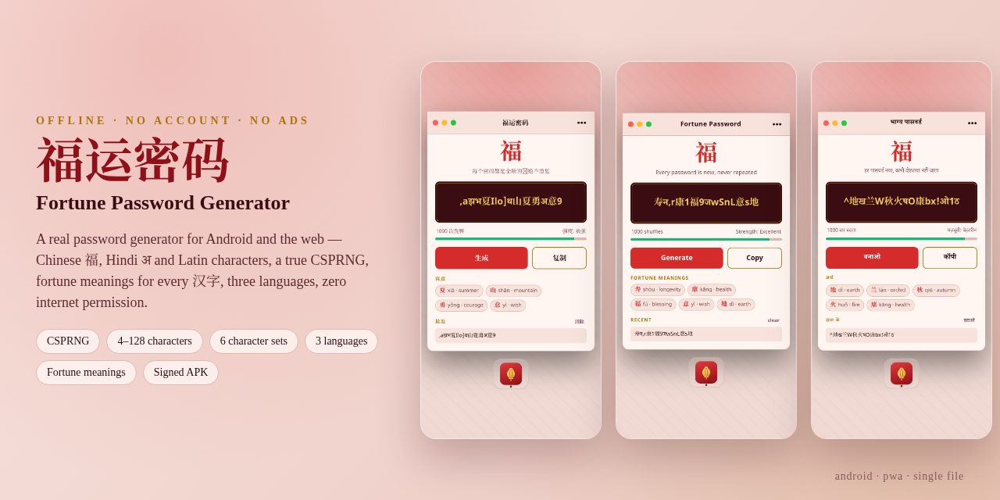
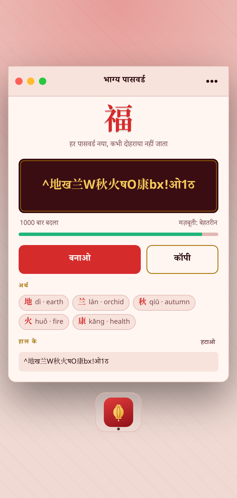
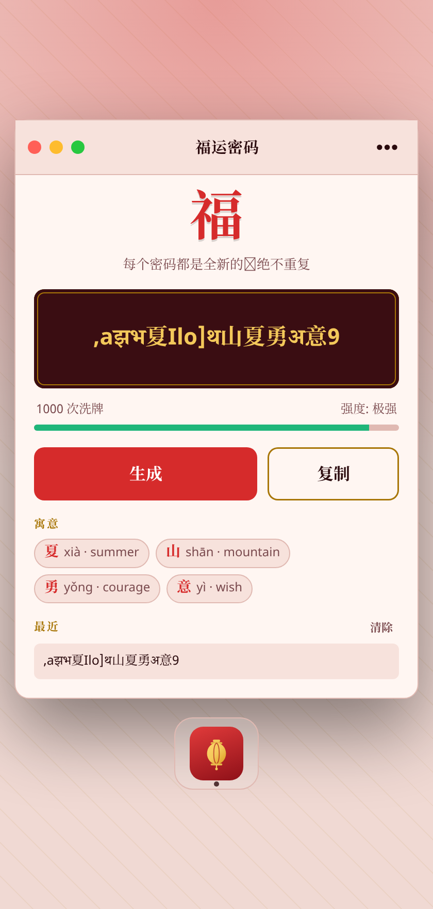

# 福运密码 · Fortune Password



**A real, working password generator for Android and the web — with Chinese 福, Hindi अ and Latin character sets.**

Not a mock-up: every password comes from `crypto.getRandomValues()`, a genuine CSPRNG, and the Android build is a signed, installable APK that runs entirely offline with **no internet permission at all**.

[ |  |  |

| Language — हिन्दी | Language — 中文 | Dark mode |
|---|---|---|
|  |  |  |

| Fortune meanings | Recent passwords |
|---|---|
|  |  |

---

## What it does

A macOS-style window floats over a Chinese New Year paper backdrop. Press **Generate** and a password is built from the character sets you choose, shuffled 1 000 times by default with a live animation, then measured for strength.

**Character sets (mix any of them)**

| Set | Contents |
|---|---|
| `A-Z` | 26 uppercase Latin letters |
| `a-z` | 26 lowercase Latin letters |
| `0-9` | 10 digits |
| Symbols | `!@#$%^&*()-_=+[]{};:,.?~` |
| 福 | 56 Chinese characters — 福禄寿喜龙凤春夏秋冬山水火木金土天地人心云月星梅兰竹菊鹤松安康吉祥如意财富平和德仁义礼智信勇光明华夏 |
| अ | 44 Devanagari letters |

**Fortune meanings** — every 汉字 in a generated password is shown underneath with its pinyin and meaning (福 fú · blessing, 智 zhì · wisdom, 竹 zhú · bamboo …). A password you can actually remember.

**Everything else**

- True CSPRNG (`crypto.getRandomValues`) with rejection sampling — no `Math.random`, no modulo bias
- Length 4–128 characters, at least one character from every enabled set, guaranteed
- No-repeat guarantee: a password is never handed out twice, and the last six stay in a Recent list
- Entropy read-out (bits) and a four-level strength meter
- Avoid look-alikes option removes `O 0 I l 1 |`
- Shuffle count (1–1000) and shuffle duration (0.3–4 s) are adjustable
- Three languages — English, हिन्दी, 中文 — switchable live, including the UI, labels and the page title
- Light / auto / dark theme, four accent colours, open-close, bounce and shuffle animations each toggleable
- Everything persists in `localStorage`; Reset all clears it
- Keyboard: `Enter` / `Space` generates, `Ctrl+C` copies
- Installable as a PWA, and works from `file://` with no server

---

## Install the Android app

1. Download **`fortune-password-1.0.0.apk`** from [Releases](../../releases/latest) (or from [`apk/`](apk/)).
2. Open it on the phone and allow install from unknown sources when prompted.
3. It asks for no permissions — there is no `INTERNET` permission in the manifest.

| | |
|---|---|
| Package | `com.fuyun.password` |
| Version | 1.0.0 (versionCode 1) |
| Size | 166 KB |
| Min / target SDK | 23 (Android 6.0) / 34 (Android 14) |
| Signature | APK Signature Scheme v1 + v2 + v3, RSA 2048 |
| Permissions | none |

The APK is a thin native shell: a `WebView` that loads `file:///android_asset/index.html` with DOM storage and JavaScript enabled, plus a `JavascriptInterface` clipboard fallback so **Copy** works even where the async Clipboard API is unavailable. The back button closes the floating window before it leaves the app.

## Run the web app

Open [`index.html`](index.html) in any modern browser — no build step, no server, no dependencies. The page is fully self-contained; the only optional extras are `manifest.webmanifest` + `sw.js` for PWA installation.

---

## Build the APK yourself

No Gradle, no Android Studio — `aapt2`, `javac`, `d8`, `zipalign` and `apksigner` directly. You need a JDK 17 and Android build-tools 34 plus a platform `android.jar`.

```bash
export SDK=/path/to/android-sdk
export JDK=/path/to/jdk-17
cd android
./build.sh          # → build/fortune-password.apk, signed
```

`build.sh` compiles resources, links the manifest, compiles and dexes the Java, packages the assets, zipaligns and signs. A keystore (`fortune.jks`) is generated on first run if one isn't present — keep your own for real releases.

To rebuild with updated web assets, copy `index.html`, `manifest.webmanifest`, `sw.js` and `icons/` into `android/assets/` first.

---

## Project structure

```
index.html                  the entire app — UI, engine, three languages
manifest.webmanifest        PWA manifest
sw.js                       offline service worker
icons/                      app + PWA icons (SVG favicon, PNG 192/512/maskable)
android/
  AndroidManifest.xml       package, minSdk 23, no permissions
  src/…/MainActivity.java   WebView shell + clipboard bridge
  res/                      label 福运密码, brand colour, launcher icons
  build.sh                  the whole build, aapt2 → apksigner
apk/                        the signed release APK
docs/screenshots/           screenshots used above
```

## Security notes

- Randomness: `crypto.getRandomValues` on a `Uint32Array`, with rejection sampling so the modulo is unbiased.
- Nothing leaves the device. There is no network code in the app, no analytics, no accounts, no ads.
- The Android manifest declares no permissions, so even a compromised WebView layer could not phone home.
- Passwords are kept only in `localStorage` on your own device, for the Recent list, and can be cleared at any time with **Reset all**.
- This is a convenience tool. For high-value accounts, prefer a dedicated password manager that stores credentials for you.

## Languages

| Language | UI | Character set |
|---|---|---|
| English | full | Latin, digits, symbols |
| हिन्दी | full | Devanagari अ–ह |
| 中文 | full | 汉字 福禄寿喜… |

Adding a language means adding one object to the `T` dictionary in `index.html`; the build has no other string source.

## License

MIT — see [LICENSE](LICENSE).

---

<sub>福运密码 · Fortune Password — 每个密码都是全新的，绝不重复 · Every password is new, never repeated.</sub>

---

## ☕ Donate / Buy me a coffee

**Coming soon** — our donation options are on the way.

| Platform | Status |
| --- | --- |
| Paytm | Coming soon |
| PayPal | Coming soon |
| GPay (Google Pay) | Coming soon |

If you like our work, you can support us with a donation. We are bringing this very soon — **coming soon**.
